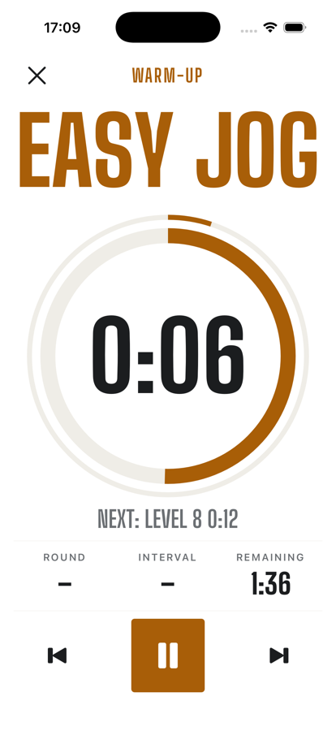
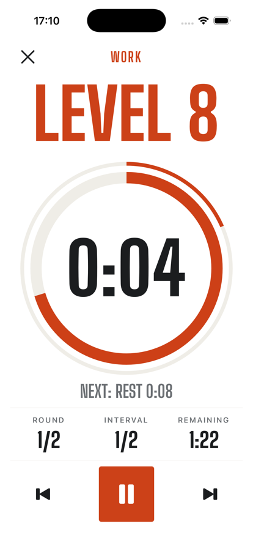
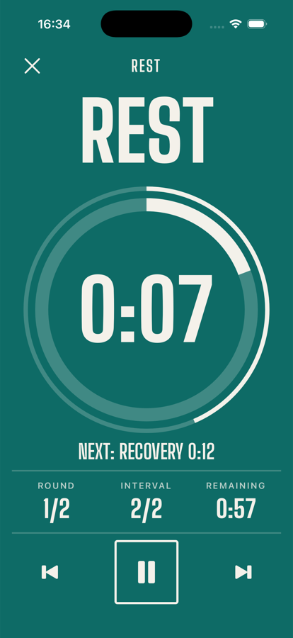
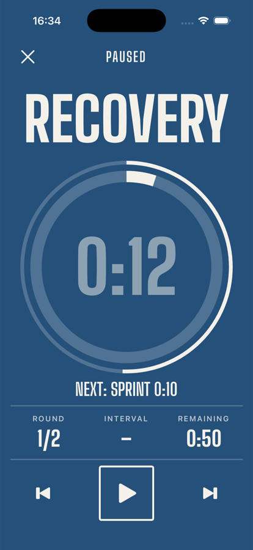
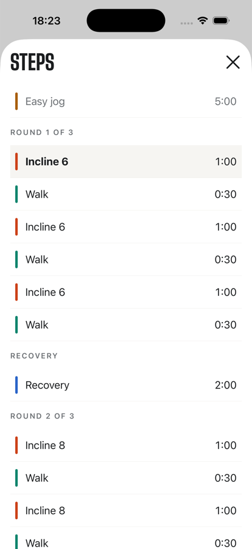
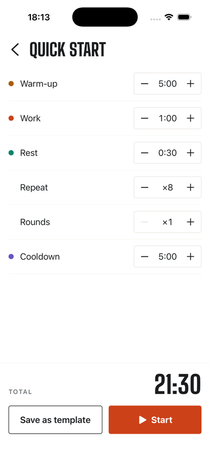
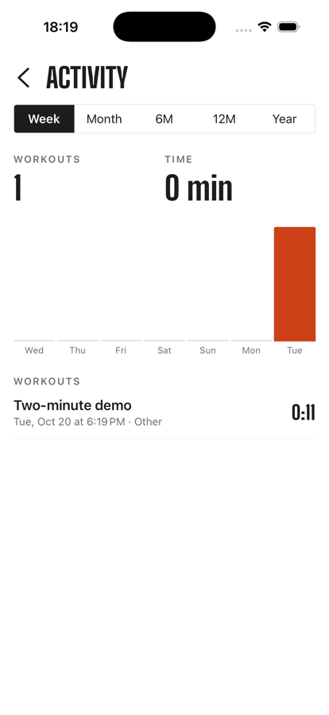

# Rounds

[](https://github.com/Mohamad-Sobhie/Rounds/actions/workflows/ci.yml)
[](LICENSE)

A cardio interval timer built for use on a treadmill, bike or rower: big, glanceable cues on screen, and audio cues that keep working with the phone locked.

> Status: feature-complete for 1.0 on iOS, preparing for TestFlight. Work is tracked in [GitHub issues](https://github.com/Mohamad-Sobhie/Rounds/issues) by milestone.

<p>
  
  
  
  
</p>
<p>
  
  
  
</p>

## Features

- Templates made of rounds, blocks and steps, with per-step labels such as "Level 8" or "Incline 6"
- Quick routine: warm-up, work, rest, repeats and rounds without saving a template
- Full-screen workout view with phase colours, progress rings and a "next step" preview
- Countdown beeps, chimes and spoken announcements scheduled natively, so they keep playing with the screen locked, over your music
- A steps sheet with the whole workout and the current step
- Export and import templates as files
- Activity history with week, month, 6-month, 12-month and year views
- Fully offline: no account, no backend

## Architecture

```
apps/mobile          Expo app: screens, state, native audio integration
  └── depends on
packages/core        Pure TypeScript: domain model, timeline compiler, timing engine, cue planning
```

A few principles drive the design:

- **Compile, then play.** A workout template is compiled into a flat, immutable timeline of segments. Everything at runtime reads from that timeline.
- **Time is derived, never counted.** The engine stores `{ startedAt, pausedAt, totalPausedMs, seekMs }` and computes the position from the current time. Nothing drifts when the app is backgrounded, and the UI only re-renders.
- **Commands as data.** Start, pause, resume and skip are timestamped commands applied to the state by a pure reducer. That keeps the engine fully testable with a fake clock and leaves room for group sessions later, where commands arrive over the network.

Design decisions are recorded in [`docs/adr`](docs/adr): the [time-derived engine](docs/adr/0001-time-derived-engine.md), the [native cue player](docs/adr/0002-native-cue-player.md), and [no telemetry](docs/adr/0003-no-telemetry.md).

```
packages/core            domain, timeline compiler, engine, cue planner      (Vitest, 95%+ engine coverage)
apps/mobile/src/app      screens (Expo Router)
apps/mobile/src/*        stores (Zustand), SQLite repositories, view models   (Jest + in-memory SQLite)
apps/mobile/modules/     cue-player: Swift Expo module on AVAudioEngine
```

## Getting started

Requirements: Node 24 LTS (see `.node-version`), pnpm via Corepack, Xcode for iOS builds.

```bash
corepack enable
pnpm install
pnpm test        # all workspaces
pnpm typecheck
pnpm lint
```

Run the app in the iOS simulator (builds a development client the first time):

```bash
pnpm --filter @rounds/mobile ios
```

## Releasing

See [docs/release.md](docs/release.md).

## Contributing

See [CONTRIBUTING.md](CONTRIBUTING.md).

## License

[MIT](LICENSE)
